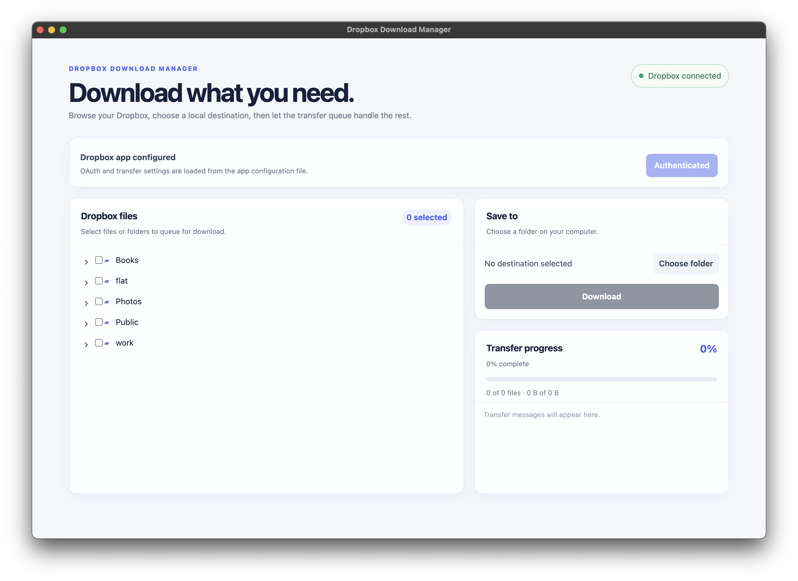

# Dropbox Download Manager

A small Electron desktop app for selecting Dropbox files or folders and downloading them through a resilient local transfer queue.



## Setup

1. Create a Dropbox API app in the [Dropbox App Console](https://www.dropbox.com/developers/apps), then grant it the `files.metadata.read` and `files.content.read` scopes. For full-account browsing, choose **Full Dropbox** access; choose **App folder** if that restricted scope is sufficient.
2. Set `dropbox.appKey` in `app.config.json` to your app key. The file is pre-created from `app.config.example.json` and ignored by Git.
3. Install and start the application:

   ```bash
   npm install
   npm run dev
   ```

Select **Authenticate with Dropbox**. The app opens the browser, and Dropbox shows an authorization code after approval; paste that code into the app. This matches the CLI-style OAuth flow, with PKCE and an offline refresh token. The app key is public; do not enter an app secret.

`app.config.json` contains all app-specific OAuth and transfer properties. In a packaged app, place this file in the application's user-data directory, or set `DB_DWNL_CONFIG` to its absolute path before launching.

## Packaging

The project uses electron-builder for installers. Build for the current platform with:

```bash
npm run dist
```

Or build a specific target:

```bash
npm run dist:mac
npm run dist:win
npm run dist:linux
```

Artifacts are written to `release/`: DMG and ZIP on macOS, an NSIS setup executable on Windows, and AppImage/DEB packages on Linux. Build each platform on that platform when possible, especially for signed releases.

After installing, copy `app.config.example.json` to the user-data config path reported by the app and set `dropbox.appKey`. Do not package access tokens or `settings.bin`; they are created per user after authentication.

## app.config.json

The App main goal was to fix buggy behavior of `dbxcli` and it's mostly repeat its functionality of browsing and downloading the dropbox files. Taking that just for the testing purposes before registering your own dropbox oauth app, you can try to use original `dbxcli` app id:
```json
{
  "dropbox": {
    "appKey": "<< Value from https://github.com/dropbox/dbxcli/blob/e3b771cb79e693452174201ea19d5d7062d18174/cmd/root.go#L37 >>",
    "authorizationUrl": "https://www.dropbox.com/oauth2/authorize",
    "tokenUrl": "https://api.dropboxapi.com/oauth2/token",
    "tokenAccessType": "offline",
    "scopes": []
  },
  "downloads": {
    "parallelDownloads": 4,
    "maxAttempts": 3,
    "retryDelayMs": 500
  }
}
```

## Download behaviour

- The Dropbox tree is loaded on demand.
- Open a folder's three-dot menu and choose **Show folder size** to total all files in that folder and its subfolders. The size appears beside the folder name; choose the action again to recalculate it.
- Choose **Refresh** in that menu to reload the folder's immediate contents from Dropbox. Existing selections and expanded branches are kept for unchanged entries; removed entries are cleared from the selection.
- File and folder selections are expanded into a transfer queue.
- Automatic system sleep is prevented while the download queue is being prepared or processed; the screen can still turn off. Normal sleep behavior resumes when the queue completes or fails.
- Transfer progress continues updating while the window is inactive. Byte updates are batched separately from a scrollable history of the latest 200 activity messages, so completed-file messages remain visible while another file downloads.
- The official Dropbox SDK streams downloads to `.part` files, uses ranged parallel requests for large files (including 10 GB files), retries recoverable failures within a run, and validates completed content before the file is committed. A new run removes any leftover `.part` file and restarts that incomplete file cleanly.
- Before each download, the app checks the destination volume for enough free space for a fresh copy.
- Existing successful files are skipped when their size matches Dropbox metadata.

Credentials are stored using Electron's operating-system-backed `safeStorage` facility where the platform provides it.
